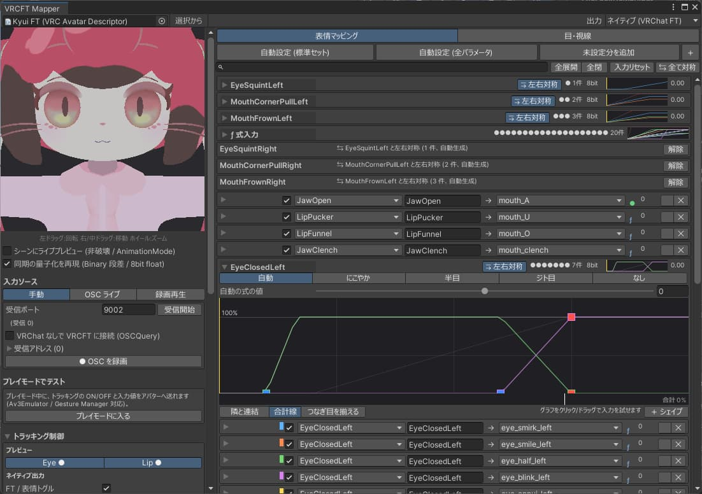

# VRCFT Mapper

Modular Avatar対応、非破壊でVRChat用のフェイストラッキング用シェイプキーを作成するUnityエディタ拡張

## 特徴

- [Modular Avatar](https://modular-avatar.nadena.dev/ja)対応
- VRChat 2026.4.1で対応したFace Tracking設定に対応
- VRCFaceTrackingからのOSC入力で受信・録画・再生・プレビュー
- 設定の左右ミラーリング、命名規則からシェイプキー自動推定
- シェイプキーの左右分離機能により、まばたきや表情を左右に分けて作成

## 準備

1. [VCC](https://vcc.docs.vrchat.com/)または[ALCOM](https://vrc-get.anatawa12.com/ja/alcom/)から、VPMに `https://vpm.hikage.works/index.json` を追加してください。
  - https://vpm.hikage.works/ にVPMリポジトリへのリンクがあります。
2. プロジェクトを作成していない場合はVCCまたはALCOMで新規プロジェクトを作成してください。
3. 対象のプロジェクトに前提パッケージをインストールしてください。
  - VRChat SDK - Base (3.10.6以降)
  - VRChat SDK - Avatars (3.10.6以降)
  - [Non-Destructive Modular Framework (NDMF)](https://github.com/bdunderscore/ndmf)
  - [Modular Avatar](https://modular-avatar.nadena.dev/ja)
4. プロジェクトを起動してください。
5. アバターをシーンに配置してください。
6. VRC Avatar Descriptorが付けられているGameObjectかそれ以下のGameObjectにVRCFT Mapperコンポーネントを追加してください。

## 機能

- OSC入力を受信しリアルタイムでプレビューやシーンに反映させる
  - プレビューウィンドウ、Playモード、Editモードに対応
- OSC入力を録画し再生
  - 実際のプレビューを見ながらパラメータを調整
- [isuzu-shiranui/UnityMCP](https://github.com/isuzu-shiranui/UnityMCP)のカスタムツールに対応
  - MCPで接続可能なツール経由でVRCFT Mapperを設定
- VRChat 2026.4のネイティブFace Trackingと従来のアニメーター方式の両方で書き出し可能

## Tips

- 各マッピングの行に変換結果 (● 直結 / ƒ 式 / ✕ 不可) を表示します。左下に Face Tracking Operations / Forwarded Parameters のランク予測と式の命令数 (上限 2048) を表示します。
- 有効判定は VRChat 標準の `UserEyeTracking` / `UserFaceTracking` から行います
- VRCFT Mapperによってメニューに追加される「Face Tracking」トグル (同期 1bit) でFace Trackingと手動表情の切り替えができます。
- カーブの式が上限 (1024 文字 / 256 命令) を超える場合は区間数を自動で減らします。
- 簡易パラメータ (EyeLid, SmileFrown など) は Unified Expressions のキーの式で近似します。パラメータ選択メニューの「ネイティブキー」から 102 キーを直接選ぶこともできます。
- 注意: VRChat 側の「マイクミュート時にアイトラッキング / フェイストラッキングを無効化」が ON だと、ミュート中は止まります。

### 式入力
- **式入力**: マッピングを開いて「式入力」を ON にすると、パラメータの代わりに Tracking Key の式を入力にできます (例: `TongueOut * (1 - JawOpen)`)。使える関数は `abs` `min` `max` `clamp`。
- **上限・下限**: マッピング一覧の下で、シェイプキーの最終値を式で制限します (例: `mouth_A` の上限 = `1 - TongueOut`)。

### シェイプキーの左右分離

左右共通のシェイプキーを、ビルド時に左右別へ分けます。たとえば、両目が一緒に動くまばたきシェイプキーを分離し、片目ずつ適用できるようにします。

## ライセンス
[MIT License](LICENSE)